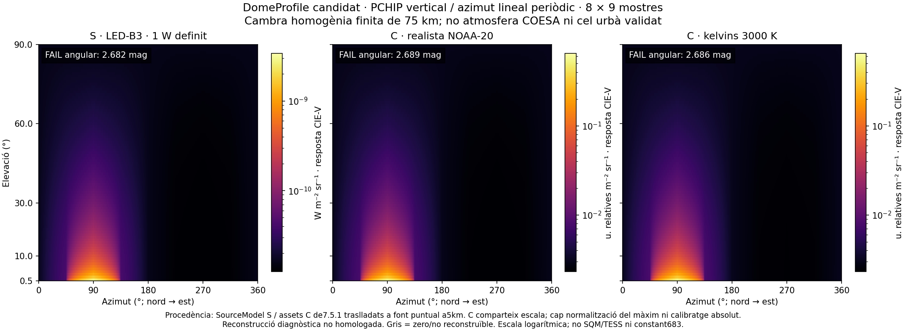
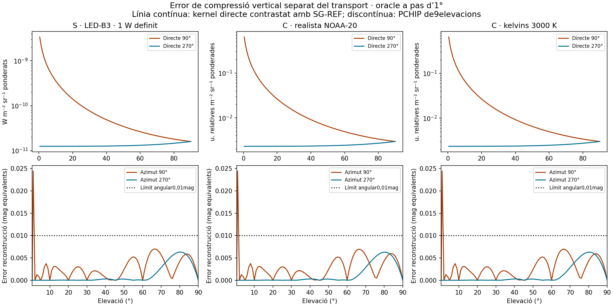
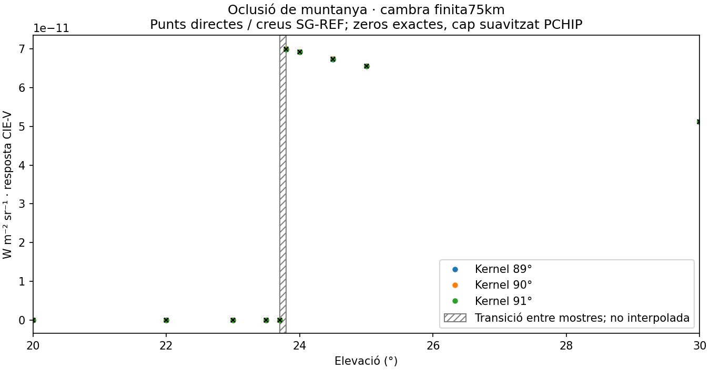

# Validació del camp angular — Pas7.13

Execució2026-10-19. **Resultat: FAIL angular; Pas7.13 pendent, funcionalitat parcial i criteri de sortida bloquejat.** Cap7.14 iniciat. [Veredicte executable](gate-angular-final.json).

## Criteri prospectiu i procedència

El [preregistre original](criteri-angular-preregistrat-v1.json), SHA256 `139ad4d4305f7185556cbc98c5102f2dedf901e28105adcc303b7c72c1bca571`, precedeix totes les comparacions.0,01mag angular és un requisit propi de resolució numèrica del projecte: exigeix aproximadament0,925% de concordança multiplicativa. No deriva dels residuals del candidat ni de l'exactitud del cel real. No consumeix ni substitueix els0,01mag de discretització espectral. Mètrica: |2,5log10(reconstrucció/directe)|; un zero físic resolt exigeix zero exacte, sense sòl. El criteri de transport heretat és10⁻⁴ amb incertesa SG-REF≤10⁻⁶, tres refinaments i marge protegit segons7.12.

La [campanya de cambra](campanya-cambra-preregistrada-v1.json) congela inputs complets, hash de codi, precisions i cost abans de qualsevol residual de la campanya. El runner original es conserva a[candidat-v1](candidat-v1/validate_angular_step7_13.py). Després de la interrupció DEM es tipa el resum i s'admet el resultat parcial; no canvien el kernel, PCHIP, fixtures, referències ni mesures. El verificador comprova el hash del runner original arxivat i el dels mòduls numèrics vigents. Els controls locals [COESA](control-standard-preregistrat.json) i[terreny](control-terrain-preregistrat.json) també registren punts/inputs abans de comparar.

## Implementació i domini

REUSE: kernel7.12, SourceModel, geodèsia ECEF/ENU, COESA75km, DEM i SG-REF. NEW: mostreig d'aplicació, PCHIP Python/TypeScript i gràfics offline. No migra cap solver TerraLab. El kernel preexistent no es modifica;90° segueix la mateixa integral que les altres direccions. La suma de fonts precedeix logaritmes. El DTO és diagnòstic escalar de la resposta ja calculada pel kernel, no el bridge final ni un nou sensor fotomètric.

PCHIP segueix les derivades harmòniques i extrems limitats de la[documentació oficial SciPy](https://docs.scipy.org/doc/scipy/reference/generated/scipy.interpolate.PchipInterpolator.html), consultada2026-10-19. Oracle SciPy independent per als golden. ε=min(Bpositiu)·10⁻¹⁵, amb admissibilitat≤10⁻¹² del mínim positiu. Els zeros exactament mostrejats es conserven; no s'interpola entre zeros ni entre zero/positiu. Barreres separen trams positius. Amb DEM no s'infereix continuïtat: consultes entre nusos retornen necessitat de transport directe, None/null. Les dades absents produeixen error de cobertura.

La cambra és P/T/O3 constants, aerosol constant, límit radial75km, dispersió simple. És un domini finit prescrit per provar numèrica, no COESA, ni un càlcul de la cua terrestre. Fonts puntuals a5km i observador100m. S: LED-B3 d'1W definit; C: assets NOAA-20 realista i3000K de7.5.1, traslladats a la mateixa geometria sintètica, conservant amplitud, SPD i escala relativa. Cap ciutat real ni calibratge absolut inferits. El control atmosfèric real del pas usa el provider COESA0–75km, perfil1km i O3 prescrit de7.12.

## Resultats mesurats

| Escenari de cambra | Direccions runtime/SG-REF | Màxim transport protegit relatiu | PCHIP vertical (mag) | Camp reconstruït (mag) | Angular |
|---|---:|---:|---:|---:|---|
| S LED-B3 |300|1,246·10⁻¹⁰|0,024466754|2,681713238|FAIL|
| C realista |300|1,224·10⁻¹⁰|0,024469820|2,688607256|FAIL|
| C3000K |300|1,232·10⁻¹⁰|0,024468706|2,686115691|FAIL|

Els300punts únics per escena inclouen72nusos8×9,182punts dels talls a90°/270° (1° més0,5°) i64punts intermedis d'azimut/elevació, amb18solapaments. No s'ha executat tota la semiesfera a resolució1°×1°. La malla inicial no captura l'estructura baixa de la font: el pitjor punt és azimut67,5°/elevació0,75°. L'error de PCHIP vertical supera0,01mag prop de l'horitzó encara que s'avaluï a un azimut mostrejat. Comparar reconstrucció amb SG-REF fi, en lloc del runtime directe, dona el mateix FAIL (diferències≤10⁻¹⁰mag al màxim). Cap llindar s'ha relaxat i cap node s'ha afegit després per amagar aquest resultat.

[Controls locals de terreny](control-terrain-resultats.json):51/51PASS a azimuts89°/90°/91°, amb27zeros exactes i màxim transport protegit1,6174·10⁻¹¹. La transició està acotada entre23,7° i23,8° per aquestes mostres; la figura no interpola la transició. El consumidor exigeix ruta directa entre mostres DEM. El primer intent de cúpula de terreny falla per cobertura del DEM±20km a azimut0°/elevació0,5°: [log original](campanya-cambra-v1-log.txt),[registre](interrupcio-cobertura-dem.json). Això impedeix un PASS de cobertura global; no és una transparència ni radiància nul·la.

[Control COESA](control-standard-resultats.json): azimut90°/elevació0,5°, radiància3,164872871171864·10⁻⁹Wm⁻²sr⁻¹ ponderada per la resposta CIE-V existent; error protegit3,4862·10⁻¹¹, PASS. Sostre75km explícit. Cota positiva exterior1,946427031628125·10⁻¹⁹Wm⁻²sr⁻¹, equivalent≤6,6774·10⁻¹¹mag amb el denominador SG-REF menys incertesa. Hipòtesis seques hidrostàtiques i aerosol prescrit de7.12: no exactitud termosfèrica/observacional. Un únic control no homologa el camp angular COESA complet.

Total: **952/952contrasts de transport PASS** (900cambra+51terreny+1COESA). El PASS directe no substitueix el FAIL de reconstrucció.

## Errors separats

- Quadratura/kernel: criteri10⁻⁴ amb SG-REF independent; incertesa protegida i refinaments guardats per raig. No s'ajusta la radiància.
- Compressió vertical:0,02447mag màxim; interpolació azimutal/perfil combinada:2,68861mag màxim. Pressupost angular0,01mag, FAIL.
- Discretització espectral: es preserven el criteri0,01mag i les evidències de7.10/7.12. Aquesta execució no torna a homologar totes les SPD/atmosferes.
- Interpolació P/T, DEM i datum: models prescrits, sense inventar una cota universal; cobertura DEM incompleta dona error.
- Truncament:75km COESA amb cota exterior positiva en el control nou.10km continuen ometent22,45% al zenit B4 històric respecte a50km. La cambra75km no justifica una cua nul·la del món real.
- Incerteses físiques: inferència urbana C, aerosols reals, composició completa, refracció i dispersió múltiple no acreditades; concordança numèrica no és exactitud observacional.

## Cost i recursos

[Pilot](pilot-cost.json):181,7258s de runtime COESA, referències4,4328/5,3973/5,6567s. [Decisió prospectiva](decisio-cost-standard.json):1272direccions projectarien250854s,69,68h; s'atura el pilot addicional i no s'executa aquesta malla. És una projecció d'un sol punt, amb concurrència parcial, no cota ni percentil. El control posterior repetit mesura193,8685s/runtime, sense relaxar quadratures. Per fonts extenses es conserva el cost fins a609s/LOS de7.12; no es generen malles denses ni s'extrapola aquesta mesura com a SLO.

Campanya900direccions de cambra:109,2930s de runtime i67,7017s per a les2700referències en total (amb concurrència parcial de controls/proves, no benchmark aïllat). Perfils3,3kB aproximadament cadascun, reconstrucció10000consultes≈0,28s al primer diagnòstic; mesures exactes al[veredicte](gate-angular-final.json), no percentils. No s'implementen caches o índexs; el checkpoint de l'eina científica només preserva mesures acabades per reprendre la campanya, no és cache de transport de producte. Cap bridge/GPU nou.

## Gràfics revisats

Les dues C comparteixen límits logarítmics i conserven l'amplitud original; cap normalització del màxim. S té escala absoluta definida i barra pròpia. La resposta CIE-V és la ponderació espectral ja present al kernel; no s'hi afegeix683, SQM o TESS. Cada gràfic adverteix que el candidat no està homologat i que la cambra no és l'atmosfera COESA.

## Proves i regressions

[474proves backend](pytest-backend-final.txt),30noves;30/30repetides després del darrer ajust de tipatge. [Frontend](tests-frontend.txt): suite completa,621comprovacions compartides amb SciPy/Python; [typecheck](typecheck-frontend.txt) i[build](build-frontend.txt) passen. Ruff i Pyright afectats nets. Pyright global de src/ manté exactament el multiconjunt67errors/3avisos anterior. Una passada exploratòria més àmplia incloent tests dona229/6 i no es confon amb aquest baseline. [Regressions](regressions.json): B0 dels900LOS i4columnes serialitzades exactes.

Tots els202fitxers d'evidència previs es preserven byte a byte, incloses les39evidències de7.12. Tot el codi del candidat de transport7.12 conserva els hashes; només s'afegeixen nous consumidors. El seu audit històric comprova una llista exacta de mòduls, i afegir DomeProfile amplia aquesta llista: no es regenera ni es reetiqueta l'arxiu anterior com a nou PASS. S'auditen els hashes originals individualment. Benchmarks B0/B1/B2/B4 preservats, sense nova afirmació de rendiment per a900LOS.

## Represa

**7.13 continua pendent, sortida bloquejada.** Cal versionar i preregistrar refinament vertical/azimutal amb punts independents, domini/cobertura DEM i cost proporcionat; mantenir0,01mag i respectar75km/cua condicionada. No reutilitzar punts de refinament com si fossin validació independent. Les fonts extenses no reben una homologació angular nova.7.14 no iniciat.

Auditoria documental:365incidències heretades inicials i355finals; zero de noves i zero enllaços trencats. [Resum diferencial](auditoria-documental-resum.json). La skill `plan` s’ha llegit; la skill complementària `terralab-manel-style` no està disponible en aquest entorn, com als passos anteriors. S’apliquen les normes locals en català.
