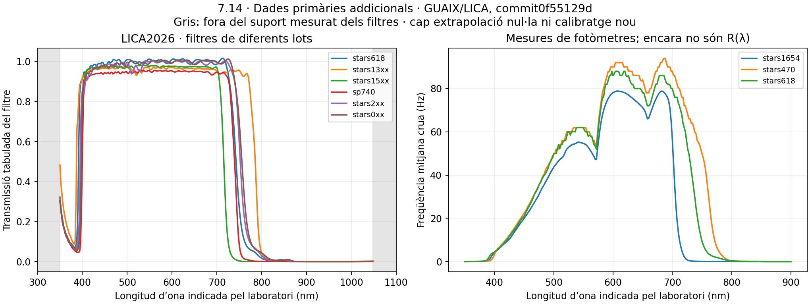

# Fonts primàries i qualificació nominal — represa 7.14

Consulta del **2026-10-20**. Es conserva íntegre el [candidat parcial anterior](../validacio-projeccions.md). Les [metadades i hashes de consulta](fonts-consultades-v2.json) identifiquen els documents originals; els PDF de fabricants i normes només s’han consultat, sense incorporar-los a la distribució. Les [15 dades de laboratori](manifest-dades-laboratori-v2.json) es conserven al commit indicat, sota la [GPL3 original](../fonts/licaplot-gpl3-license.txt).

## Què és suficient per a un model nominal

Una banda AB nominal es defineix amb la resposta espectral d’energia, la coordenada de λ, la normalització AB i un model angular amb cobertura suficient. **No necessita per definició el número de sèrie, el fosc o el guany d’un aparell particular.** Una resposta nominal verificable és admissible si se’n delimiten el model i les incerteses. La incertesa d’un model nominal no es converteix en exactitud observacional de 0,01 mag.

Predir Hz requereix, a més, una conversió radiomètrica absoluta i el fosc en un domini tèrmic identificat. Predir magnituds natives exigeix també el seu zero point. Comparar-les amb observacions afegeix resposta real, temperatura, envelliment i incerteses experimentals. No es traslladen constants d’una unitat a una altra sense justificar-ho. Aquesta separació està provada a `InstrumentEvidence`/`qualify_instrument`: un model nominal complet sense calibratge individual és admissible; una lectura nativa sense aquest calibratge no ho és.

La formulació de [Bará, Tapia i Zamorano2019](https://doi.org/10.3390/s19061336) separa resposta espectral, FOV i calibratge. Els 3631 Jy/arcsec² d’AB fixen una referència de radiància: no són un offset ajustat per imitar una lectura SQM/TESS. Les seves incerteses instrumentals publicades, de l’ordre de 0,06 mag per als exemples, no substitueixen ni relaxen el pressupost **numèric** de 0,01 mag.

## SQM: model ample, model amb lent i components

La [FAQ del fabricant](https://www.unihedron.com/projects/darksky/faqsqm.php) distingeix el SQM ample (HWHM aproximadament 42°, angle sòlid efectiu publicat 1,532 sr) del SQM-L amb lent (HWHM aproximadament 10°). SQM-LE comparteix l’òptica de SQM-L. Per tant, una resposta espectral CM500 de l’informe2005 i una gaussiana20° de SQM-L són components d’un diagnòstic declarat; no constitueixen automàticament un únic model físic verificat. La distinció important és el **model òptic**, no exigir sempre la mateixa unitat individual.

[Cinzano2005, distribuït per Unihedron](https://unihedron.com/projects/darksky/sqmreport_v1p4.pdf), construeix la resposta calculada multiplicant responsivitat TSL237 i transmissió CM500, i la contrasta experimentalment. Les diferències observades no són una tolerància uniforme de 0,01 mag. SVO publica una digitalització finita de la figura8, no una mesura de totes les cues. La còpia anterior 313,2–739,4 nm continua intacta i acaba amb resposta no nul·la.

El [datasheet ams OSRAM TSL237, v1-01 de 2018](https://look.ams-osram.com/m/7de13fb52f0fa149/original/TSL237-DS000156.pdf) aporta:

- Figura10: **responsivitat d’energia**, no eficiència quàntica. No s’hi afegeix un altre factor λ com si fos un comptador de fotons.
- Interval de resposta descrit 320–1050 nm i gràfic típic aproximadament 300–1100 nm. Un interval de caracterització no és una cota certificada de resposta exactament nul·la fora d’aquest interval.
- Fosc típic 0,1 Hz a25°C i límit de 2 Hz a50°C en les condicions de la taula; la figura15 també explica offsets interns negatius. No és una mesura del fosc de qualsevol fotòmetre.
- Fórmula de dispositiu `fO=fD+Re·Ee`, variació amb temperatura i dues seccions angulars. L’òptica exterior del fotòmetre també intervé en el FOV.

La [taula CM500 del fabricant, distribuïda per Unihedron](https://unihedron.com/projects/darksky/hcm500_files/CM500.pdf) declara gruix nominal **1 mm**. Alguns punts de transmissió total són:

| λ indicada (nm) | T (%) |
|---:|---:|
| 700 | 1,8 |
| 740 | 0,17 |
| 750 | 0,10 |
| 800 | 0,008 |
| 1100 | 0,08 |
| 1500 | 15,0 |
| 2000 | 72,0 |

Els buits de la taula no s’han omplert amb zero. La transmissió torna a augmentar en IR llarg; això **no** implica que el SQM el detecti, perquè la resposta del silici és una altra funció. El filtre sol tampoc acredita el suport complet del sistema. Cal fixar el model CM500/TSL237/òptica i acotar-ne les regions no tabulades abans d’una integral instrumental completa. No s’ha calculat un nou calibratge multiplicant taules incompatibles ni s’ha digitalitzat un gràfic amb una falsa precisió.

El [manual SQM-LR de2025](https://www.unihedron.com/projects/darksky/cd/SQM-LR/SQM-LR_Users_manual.pdf) documenta calibratge de fàbrica, període fosc i temperatura. Permet entendre la lectura nativa; no proporciona per si sol la funció nominal completa de resposta o una cota de totes les cues.

## TESS-W: versions, lots i noves dades accessibles

L’[article de disseny de Zamorano i col·laboradors](https://doi.org/10.26607/ijsl.v18i0.21) descriu TSL237, filtre dicroic, col·lector i finestra, amb FOV aproximadament gaussià de17°. El desplegament inicial i els offsets empírics que hi apareixen són una història instrumental concreta; no s’han adoptat com a constants universals.

L’[informe LICA de2026](https://doi.org/10.5281/zenodo.22873442), versió interna1.0 datada2026-07-01 i publicada a Zenodo el setembre2026, compara lots de filtres i fotòmetres. Els seus talls de FOV donen aproximadament20°, amb asimetries/baselines, i no un model hemisfèric exacte. Els punts de tall vermell i les respostes de lot difereixen. Un calibratge amb LED ambre centrat prop de595 nm compensa sensibilitat a aquella il·luminació, però no elimina diferències de resposta per a qualsevol espectre. El mateix informe mostra contrasts diferents per al cel fosc CAHA i per al cel de Madrid; els nivells de referència dels seus exemples són prescrits, no un calibratge absolut del kernel.

Les dades referenciades al text s’han localitzat al [repositori primari licaplot](https://github.com/guaix-ucm/licaplot/tree/0f55129d6a27ccfe489558f1f46d441e278626f6/report), amb commit fixat:

- Sis mesures de filtres amb350 nusos entre350i1048 nm, amb corrents, soroll de lectura, referència de fotodíode i transmissió processada. Els scripts del report retallen alguns gràfics a900 nm, però els fitxers originals cobreixen més enllà.
- Tres parelles de dades de fotòmetre/fotodíode (stars470, stars618 i stars1654), amb276 nusos entre350i900 nm i estadístics de freqüència.
- Dos assaigs de FOV (stars237 i stars630), amb talls en dues orientacions i controls amb la font apagada. Les coordenades de goniòmetre van de20a100° en els fitxers; no es confonen amb una cobertura de tota la semiesfera.
- La taula de responsivitat normalitzada TSL237 utilitzada pel laboratori.



El gràfic de freqüència és **f(λ) crua sota la il·luminació del banc**; no es presenta com si fos una R(λ) calibrada. La conversió requereix el fotodíode, la seva responsivitat i el tractament de fons/il·luminació corresponent. Els controls de FOV amb font apagada inclouen l’entorn de l’assaig; no s’han traslladat com a fosc intrínsec d’una mesura espectral d’un altre dia. Els extrems de freqüència nul·la d’algunes corbes no acrediten totes les cues fora350–900 nm.

La mesura anterior stars1277 entre350i1045 nm es conserva, però no s’empalma amb aquests altres lots per fabricar un perfil únic. El nom genèric TESS-W necessita una versió o model òptic/lot de referència; una unitat representativa ben caracteritzada pot servir com a nominal, sense exigir el calibratge de totes les unitats de camp. Les dades consultades encara no proporcionen el suport/cota i la convenció de λ necessaris per tancar aquest perfil.

## Aire/buit: resolució explícita, sense reescriure el passat

La [CIE identifica V(λ) en aire estàndard](https://cie.co.at/datatable/cie-spectral-luminous-efficiency-photopic-vision). La definició3.5 de la [mostra d’ISO/CIE11664-2:2022](https://cdn.standards.iteh.ai/samples/77215/7c13ff8454764de2985cc77163df13ee/ISO-CIE-11664-2-2022.pdf) remet explícitament a CIE018:2019 i fixa aire sec,15°C,101325Pa i450ppm de CO₂. No s’ha confós amb la convenció històrica300ppm o amb l’aire ambient al llarg d’una LOS.

La [formulació NIST/Ciddor](https://emtoolbox.nist.gov/Wavelength/Documentation.asp) dona l’índex de fase en funció de λ de buit. La nova versió calcula i inverteix `λair=λvac/n(λvac)`, en el domini300–1700 nm. En una simple transformació de coordenada:

```text
T_vac(λvac) = T_air(λair)                   resposta: cap jacobià
L_vac(λvac) = L_air(λair) · dλair/dλvac      densitat per nm: jacobià obligatori
∫ L_air dλair = ∫ L_vac dλvac               potència conservada
```

La referència AB s’avalua en λ de buit, amb c i3631 Jy. Això no implementa refracció geomètrica ni altera ECEF/ENU. Les dades de laboratori que només indiquen «nm» continuen amb convenció no acreditada; les dues interpretacions comparades són **hipòtesis**, no metadades descobertes.

La projecció nova consumeix el polinomi de les dades retingudes declarades explícitament en buit. Reponderar-lo amb V corregida **no transforma la SPD que es va transportar**. La correspondència d’una SPD de catàleg amb aire/buit s’ha de declarar abans d’un futur transport coherent; la utilitat de canvi de densitat conserva la seva integral. No s’han reetiquetat retroactivament fonts, CCT, bandsets, magnituds ni evidències anteriors.

El [diagnòstic de dues hipòtesis](diferencies-hipotesis-coordenades-v2.json) quantifica aquesta qüestió sense repetir integrals: les referències fines ja calculades difereixen fins a0,01410mag en CIE i0,01158mag en SQM per a un espectre subnm prop de700nm. És una diferència de problemes, no error numèric, i confirma que no s’ha d’assumir negligible la coordenada. CIE2019 queda fixada per la norma; les hipòtesis no substitueixen metadades del laboratori.

## Cobertura i què falta exactament

Un FOV nominal prescrit pot definir-se matemàticament complet sense mesurar individualment totes les unitats. Un pes molt petit fora de la malla, però, només dona una cota d’error si hi ha també una cota de radiància o de contribució integrada en aquella regió. La nova funció `missing_coverage_error` admet aquesta justificació: **no exigeix calcular sempre cada punt**, però tampoc substitueix radiància desconeguda per zero. Els controls de gaussianes17/20/84° mostren les fraccions absents i un exemple amb cota explícita; aquest exemple no es promou a una cota física de cap escena.

El [diagnòstic addicional de components](diagnostic-cobertura-components-v2.json) acota condicionalment el filtre absent per0≤T≤1 dins la taula del xip. Dona un marge màxim de referència AB de0,09925–0,11365mag, davant0,001mag de cobertura. No és l’error real del TESS-W: és la insuficiència d’aquest embolcall conservador per certificar precisió. Fora de la taula del xip la resposta continua desconeguda, i la cota física total és `None`.

Per acabar 7.14 encara cal:

1. Un **perfil nominal òptic seleccionat** per a SQM i TESS-W amb resposta espectral, convenció de λ i suport/cotes suficients. No cal com a condició general el calibratge individual de cada instrument; tampoc és suficient denominar-lo simplement SQM o TESS-W.
2. Un camp espectral o senyals de banda compatibles amb aquell perfil i cobertura del FOV justificada dins el domini de7.13, o cotes d’error suficients per a les parts absents. El camp CIE escalar no permet recuperar SQM/TESS. COESA general, DEM i fonts extenses no han rebut una nova homologació angular.
3. Superar amb aquell perfil el gate numèric preregistrat i el pressupost de cobertura/combinat. Les lectures natives i la validació observacional tenen requisits addicionals, separats del gate nominal.

No es publiquen magnituds SQM/TESS absolutes de C, offsets arbitraris, lectures natives incompletes ni nova equivalència Bortle. L’estat segueix bloquejat per **resposta nominal o cobertura insuficients**, amb la convenció CIE resolta i la distinció nominal/dispositiu corregida.
