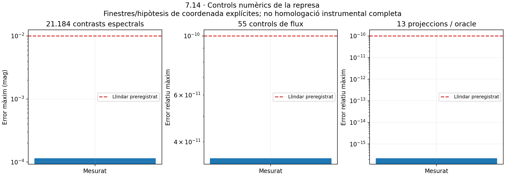

# Represa de 7.14 — coordenades i qualificació nominal

Execució del **2026-10-20**. El [gate de represa](gate-represa-v2.json) manté **PASS numèric** i **sortida científica bloquejada**, ara amb `BLOCKED_NOMINAL_RESPONSE_OR_COVERAGE`. No s’ha començat7.15. El [candidat parcial v1](../validacio-projeccions.md), els seus resultats, figures, preregistres i vinculacions continuen intactes.

## Resultat i bloqueig delimitat

S’ha resolt el canvi explícit de coordenades **aire/buit per a CIE2019**, amb jacobià per a densitats i referència AB coherent en buit. S’ha separat la banda AB d’un model nominal, les prediccions natives d’un dispositiu i les observacions. **El calibratge individual no és un prerequisit general d’un model nominal AB.** El nou codi ho prova expressament; les absències de calibratge natiu no es fan servir per bloquejar per si soles una simulació nominal.

Les [fonts primàries i dades addicionals](fonts-i-qualificacio-v2.md) encara no permeten identificar i delimitar un perfil nominal SQM/TESS complet, amb convenció de λ i cues acotades. També falta un camp espectral/de banda i una cobertura del FOV suficients dins el domini angular acreditat. No s’ha substituït això per offsets, respostes nul·les desconegudes o una extrapolació del camp CIE.

## Implementació nova i compatibilitat

- [Coordenades](../../../../backend/src/terralab3d/domain/wavelength_coordinates.py): Ciddor/NIST, aire sec15°C/101325Pa, convencions450ppm i300ppm diferenciades, inversió, jacobià i exportació versionada al contracte de taules lineals. Rebutja convencions absents i extrapolació fora300–1700nm.
- [Qualificació](../../../../backend/src/terralab3d/domain/instrument_qualification.py): objectius `nominal_ab`, `native_frequency` i `native_magnitude` amb requisits diferents. Escala C relativa no produeix lectura absoluta. Un pes absent petit exigeix una cota de radiància/contribució suficient.
- [Postprocessament](../../../../backend/src/terralab3d/application/coordinate_photometry.py): integra la resposta en la seva coordenada correcta contra el polinomi retingut. Separa els nusos de resposta i els panells, comprova positivitat entre nodes i no travessa suports desconeguts. Publica el refinament i una estimació LOS projectada, no una incertesa física total.
- [CLI explícit](../../../../tools/project_coordinate_photometry_step7_14_v2.py): exigeix declarar `--input-radiance-basis vacuum_nm` i escriure en un fitxer nou. Les [dades de demostració](demostracio-cli-cie-v2.json) s’han generat sense repetir transport.

La retenció espectral, el kernel i el CIE anterior no s’han modificat en aquesta represa. La transformació de la resposta **no** reconverteix la SPD que ja es va transportar. La correspondència d’una SPD física de catàleg amb una coordenada s’ha de declarar abans d’un futur transport; la utilitat de densitats en conserva la integral. Això resol el contracte i l’operació aire/buit, sense reetiquetar retrospectivament catàlegs, fonts, CCT o evidències. Les taules de laboratori amb «nm» sense convenció continuen explícitament no qualificades.

La ruta CIE nova i la v1 són versions diferents. S continua amb la mateixa amplitud SI i C amb la seva escala condicionada. No hi ha calibratge urbà, magnitud SQM/TESS nativa o equivalència Bortle nous. El canvi de coordenada no és refracció geomètrica ni duplicació de geodèsia.

## Preregistre i cost controlat

El [criteri v2](criteri-represa-preregistrat-v2.json), SHA-256 `babc518000b27dae4ffd0909bb13e1282d7b86894b5ee70678cb848c35b4d780`, es va congelar abans de comparar candidats. Manté **0,01 mag espectral**,10⁻¹⁰ relatiu per projecció/AB i0,0001mag per quadratura FOV. Registra toleràncies de canvi de variable, cobertura≤0,001mag i pressupost numèric combinat≤0,01mag. Una cobertura desconeguda impedeix demostrar aquest últim: no s’ha substituït per zero ni s’ha creat un llindar0,011mag.

S’han preservat dues vinculacions de la represa. El primer control es va aturar als **108,363s**, sense cap LOS nova, perquè recalculava tots els nusos de resposta per cada panell. Es conserven [vinculació v2](vinculacio-candidat-v2.json), [codi original](candidat-v2-abans-reutilitzacio/) i [cost/log](costos-campanya-v2-primer-intent.json). L’[esmena prospectiva de reutilització local](esmena-reutilitzacio-local-preregistrada-v2-1.json) comparteix aquests mateixos nusos dins d’una projecció, abans de repetir el control. No altera les funcions, els llindars, els nodes o la física. La [vinculació v3](vinculacio-candidat-v3.json) identifica el codi mesurat final.

Només s’ha reutilitzat preparació local de resposta: cap cache entre peticions, nova vectorització, acceleració espacial o multicore. La campanya és en sèrie, amb un fil BLAS/OMP i **zero LOS físiques noves**.

Una [esmena bibliogràfica](esmena-referencies-formules-v2.json) corregeix els números de les equacions NIST citades al preregistre: A22/A32/A35. El codi i els coeficients numèrics ja corresponen a aquestes expressions; no hi ha canvi de candidat, dades, criteris o resultats.

## Controls i oracles independents

| Control | Resultat real | Criteri |
|---|---|---|
| 21.184 contrasts espectrals | Tots PASS; màxim0,000115196684mag | ≤0,01mag |
| Resolució de l’oracle espectral | Màxim relatiu9,010·10⁻⁹ | ≤10⁻⁶ |
| 55 conversions de densitat, integral conservada | Totes PASS; màxim relatiu3,4735·10⁻¹¹ | ≤10⁻¹⁰ |
| 13 projeccions CIE / oracle independent | Totes PASS; màxim relatiu2,2205·10⁻¹⁶ | ≤10⁻¹⁰ |
| Conversió/inversió, jacobià i AB | 26 proves noves PASS amb Decimal60, QUADPACK i inversió independent | Toleràncies prospectives de v2 |
| Sis diagnòstics de cobertura de components | Oracles GL/QUADPACK PASS | ≤10⁻¹⁰ relatiu |

Els [contrasts espectrals](pressupost-espectral-v2.json) reutilitzen el harness7.10 **sense modificar**. Les55 SPD i64 operadors heretats es combinen amb tres finestres de resposta i dues hipòtesis explícites de coordenada. Les SPD d’aquesta campanya mantenen el problema tabulat heretat en buit; les conversions de densitat es comproven separadament. Les hipòtesis SQM/TESS no identifiquen la coordenada real del laboratori. L’oracle fi GL8/16/32 conserva els40.001 nusos originals d’absorció. L’error Simpson màxim és6,432·10⁻¹¹mag; la LUT O3 domina el residual. [CSV cru](espectral-v2/casos-pressupost-espectral.csv.gz).

Els [controls de flux i postprojecció](coordenades-i-postprojeccions-v2.json) inclouen SPD tabulades, kelvins, mescles i triangles subnm. La integral nativa lineal proporciona la referència exacta de flux; Decimal60 comprova conversió i inversió. Les13 dades retingudes es projecten amb GL8/16 contra un oracle QUADPACK amb interpolació de Lagrange i formulació independent de la coordenada. No es comparteixen els coeficients quadràtics del candidat. Els zeros físics continuen exactes; una magnitud del zero no es fabrica.



Aplicar V en la coordenada corregida canvia els senyals de les fixtures respecte de la versió tabulada anterior fins a **0,001151420mag**. És una diferència de convenció/model, **no** error de quadratura ni un calibratge. No s’ha restat ni ajustat. La SPD retinguda i l’escala de cada font continuen sent les originals.

La [comparació descriptiva de les dues hipòtesis](diferencies-hipotesis-coordenades-v2.json), feta amb les referències fines ja calculades, mostra que no sempre es pot negligir aquesta distinció. En3.520 parelles per resposta, la diferència màxima aire/buit és0,0140994mag per CIE,0,0115759mag per la finestra SQM i0,0007674mag per la finestra TESS. Els dos primers màxims corresponen al triangle subnm prop de700nm. **No són FAIL numèrics**: els dos problemes diferents estan integrats amb precisió. CIE té convenció coneguda i corregida; el laboratori SQM/TESS no queda identificat per comparar hipòtesis. El màxim menor de TESS tampoc és una prova uniforme per a qualsevol espectre ni resol les cues.


## Cobertura espectral i angular

La inspecció dels fitxers originals ha trobat **350 nusos de filtre entre350i1048nm**, més enllà dels gràfics retallats a900nm dels scripts. Les dades de fotòmetre/fotodíode de tres unitats cobreixen350–900nm. No s’han empalmat amb stars1277 d’un altre assaig/lot per fabricar una única resposta completa. Els valors de transmissió lleugerament superiors a1 es conserven com a mesures amb soroll/normalització, sense retall arbitrari.

Un [diagnòstic de components](diagnostic-cobertura-components-v2.json), amb [preregistre addicional](criteri-diagnostic-cobertura-preregistrat-v2.json), considera explícitament `R_chip×T_filtre` en una hipòtesi de λ de buit. Dins del suport tabulat del xip, el filtre no mesurat s’acota condicionalment per passivitat,0≤T≤1. Es mantenen les mesures conegudes; no s’inventa una cua nul·la ni s’atribueix aquest model simplificat a tota l’òptica del TESS-W.

La incertesa màxima condicionada de referència AB de les regions UV/IR absents **dins la taula del xip** és0,09925–0,11365mag segons el filtre, davant l’assignació de cobertura0,001mag. Això no demostra que l’error real sigui d’aquella mida: mostra que la informació i aquest embolcall conservador no certifiquen una cota prou petita. La resposta **fora** de la taula del xip encara té cota desconeguda; `fullPhysicalBoundMag=None`. Tampoc inclou incertesa del banc, finestra o col·lector. No s’han convertit aquestes cotes parcials en una homologació física.

Els [controls angulars](qualificacio-i-cobertura-v2.json) integren el pes absent sota0,5° per a gaussianes nominals17/20/84° al zenit. Sense cota de radiància retornen `UNAVAILABLE`; amb una cota explícita poden donar PASS. El segon cas és un exemple matemàtic, no una cota física acreditada de l’escena. Un model nominal pot justificar cobertura mitjançant cotes, sense calcular cada punt o calibrar individualment tot l’instrument.

El DomeProfile de7.13 continua sent un camp escalar CIE. No conté tot l’espectre per a SQM/TESS. El domini COESA segueix limitat al perfil registrat; DEM i fonts extenses continuen amb les seves rutes directes i limitacions. Aquesta represa no amplia cap homologació angular. Es preserven **75km i la cota superior positiva condicionada**, així com l’evidència històrica del22,45% omès a10km en la fixture B4; no s’han repetit aquells transports.

La [cota exterior per a la CIE corregida](cota-exterior-cie-v2.json) es comprova amb l’operador analític existent de7.12, sense nova LOS: com que0≤V≤1, una resposta plana1 en tot el suport de la font domina també la V transformada. La cota de radiància és positiva,6,4713·10⁻¹⁸W·m⁻²·sr⁻¹; equival com a màxim a7,7593·10⁻⁷mag respecte del senyal CIE protegit pels pressupostos heretats. Compleix el criteri de cua≤0,001mag congelat a7.12. Continua condicionada a les mateixes hipòtesis seques hidrostàtiques i d’aerosol, sense assumirP(infinit)=0 o modelar la termosfera observada.

## Proves, regressions i preservació

- [540 proves backend](pytest-backend-v2.txt) PASS en43,39s,26 de noves. Inclouen les proves CIE/retenció/projecció anteriors, font S/C, absències, zeros, positivitat del polinomi, convencions, conservació i la distinció nominal/nativa.
- [Frontend](frontend-tests-v2.txt), [typecheck](frontend-typecheck-v2.txt) i [build](frontend-build-v2.txt) PASS. No hi ha canvi funcional frontend.
- Pyright dels fitxers nous: zero errors/avisos; globalment es conserva exactament el mateix multiconjunt de **67 errors/3avisos** heretats. [Diagnòstics globals](pyright-global-v2.json).
- [B0 i quatre columnes](columnes-b0-v2.json) exactes; signatura B0 `21d3453df822b95d56aa508fee6bd9c76e712b27c63f3f03a3222e86e075b53e`. El gate numèric del candidat parcial anterior també es repeteix amb PASS.
- **449 evidències anteriors** preservades per hash. Els documents vius anteriors i `.gitattributes` tenen [instantànies exactes](preservacio-inicial-v2.json), empaquetades [byte per byte en ZIP](instantanies-docs-candidat-parcial-v1.zip), amb [índex de rutes originals i hashes](index-instantanies-docs-v1.json). Així no es presenten còpies congelades com a documentació navegable amb enllaços relatius vius. El registre inicial es conserva i l’auditoria resol les entrades arxivades. Les actualitzacions documentals presents es distingeixen de les evidències científiques immutables; cap fitxer científic anterior ha canviat.
- Es preserven el control de cost interromput, el primer candidat de represa i els logs de qualitat. Un nom local ambigu a l’eina de figures s’ha corregit després del primer Ruff; no afecta la campanya científica. Les verificacions finals indiquen el resultat vigent.
- [Verificacions finals](comprovacions-finals-v2.json): Ruff i Pyright dels dotze fitxers nous passen; gate numèric0 i gate complet1 pel bloqueig explícit. No s’ha repetit la campanya física per canvis en figures o auditoria.
- [Auditoria documental](auditoria-documental-resum-v2.json):355 incidències mecàniques heretades, cap de nova i zero enllaços locals vius trencats. Les instantànies congelades es comproven dins el ZIP, sense canviar els validadors o amagar errors de documents vius.

## Cost real

| Fase | Temps de paret de procés |
|---|---:|
| Primer control aturat | 108,363s |
| 55 conversions +13 projeccions/oracles, amb reutilització local | 27,729s |
| Campanya espectral | 42,871s |
| Qualificació i controls angulars | 0,887s |
| Total de la campanya, inclòs l’intent interromput | **179,850s** |

Els diagnòstics addicionals registren separadament aproximadament0,22s de càlcul intern de components,0,39s de preparació/cota exterior CIE i el temps de lectura/comparació de les hipòtesis ja calculades, sense incloure arrencada de Python. Descàrrega de fonts, proves, figures i auditoria queden fora del temps científic anterior. Les estimacions es van fer abans de cada campanya; no s’ha abaixat precisió per rendiment. El límit prospectiu era900s i zero LOS noves.

El postprocessament CIE amb canvi exacte de coordenades costa **0,787–0,888s per LOS** sobre les dades retingudes, amb controls i partició fina. És una operació diferent de les projeccions lineals antigues de3–5ms; no se li atribueix aquell cost. Conserva zero transport addicional. Els benchmarks B0–B4 i els costos físics previs, incloent fonts extenses lentes, continuen intactes. No s’infereix cap SLO o acceleració futura.

## Reproducció i punt de represa

Des de l’arrel, sense executar transport nou:

```powershell
python -X utf8 tools/audit_photometry_resume.py --numeric-only
python -X utf8 tools/audit_photometry_resume.py
python -X utf8 tools/plot_photometry_resume.py
python -X utf8 tools/project_coordinate_photometry_step7_14_v2.py --input docs/evidencies/pas7.14/transport-i-projeccions.json --case S_B4_chamber_point_5km-0 --input-radiance-basis vacuum_nm --output .runtime-photometry-v2/projeccio-usuari.json
python -X utf8 tools/audit_photometry_resume.py --verify-manifest
```

El gate sense `--numeric-only` retorna **1** pel bloqueig científic; el control numèric retorna0. La comprovació del manifest és de lectura. Les carpetes científiques existents no s’han de sobreescriure per repetir una campanya.

El [Pas7.14](../../../tasques/pendent/pas7.14-photometric-projections.md) continua pendent i parcial. La represa requereix seleccionar i completar el perfil **nominal** SQM/TESS, identificar la convenció de λ i acotar les cues, i demostrar la cobertura del camp espectral/FOV dins el domini justificat. Les prediccions natives i l’homologació observacional tenen requisits addicionals separats. **No començar7.15** fins a demostrar el criteri vigent; no s’han relaxat llindars ni alterat7.18–7.22.
