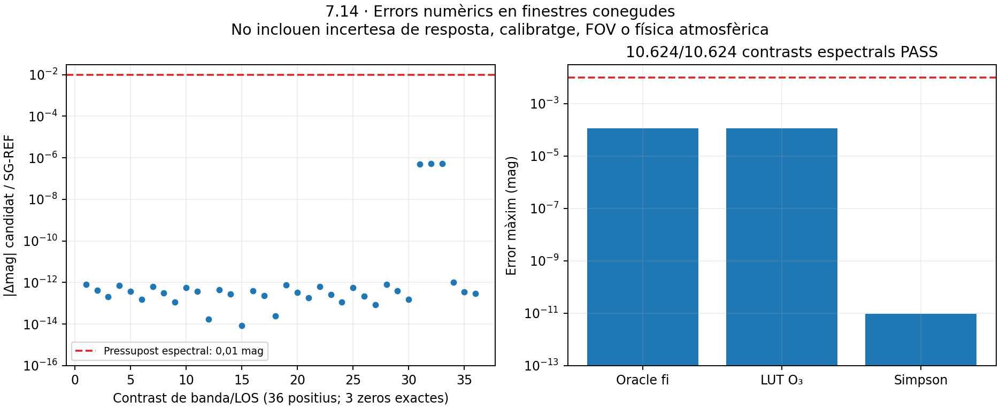

# Validació de projeccions fotomètriques — Pas 7.14

Execució del 2026-10-19, base Git `7ccd688811c8452a49a78ef7e884c89a4c6a528c`. **Estat del pas: pendent, funcionalment parcial i bloquejat científicament.** El [gate](gate-projeccions-v1.json) dona `numericStatus=PASS`, `scientificExitPassed=false`, `status=BLOCKED_SENSOR_PROFILES`. No s’ha començat 7.15 ni s’ha alterat el planning 7.18–7.22.

## Abast implementat

El mateix kernel reté opcionalment densitats de radiància per nm als tres nodes de cada panell espectral. Es reutilitzen geometria, terreny, interseccions, mostreig, fases i columnes; no hi ha un integrador fotomètric de transport separat. La retenció usa la quadratura vectorial GK15 existent, amb control per λ i el límit d’intervals compartit. La ruta escalar antiga continua disponible sense retenció. Els [dos fitxers anteriors](codi-kernel-previ/) es conserven exactes.

`retain_spectrum` uneix els nusos de totes les respostes previstes abans d’una sola petició de transport. `project_retained` només consumeix les dades retingudes, suma fonts linealment amb unitats/escala/suport compatibles i publica la revisió vigent. No divideix per V(λ), no reconstrueix un espectre d’un escalar i no crida el kernel. Cancel·lació o revisió antiga descarten el resultat complet. Un nus de resposta absent requereix dades noves: no s’inventa una interpolació garantida.

Per a S, `Lλ` té unitats W·m⁻²·sr⁻¹·nm⁻¹; integrar la resposta produeix W·m⁻²·sr⁻¹ i `683∫LλV(λ)dλ` produeix cd/m² del component artificial modelat. Per a C les mateixes operacions conserven escala relativa; no es publiquen cd/m² ni magnitud absoluta. La conversió explícita de nW·cm⁻² a W·m⁻² és 10⁻⁵. El contrast relatiu de magnitud exigeix mateixa escala, banda i suport.

La referència AB integra analíticament una resposta d’energia tabulada contra 3631 Jy/arcsec², amb `Ω=(π/648000)² sr`. Es contrasta amb Decimal50 independent. No és un zero point natiu en Hz. `--reference-bands` publica únicament un diagnòstic AB direccional condicionat per a S: la referència és tota la corba tabulada identificada, el numerador correspon al suport explícit de la font/transport. El camp `domainNm` indica aquest últim. Això no afirma resposta nul·la fora del suport conegut d’un sensor real. Zero exacte no es converteix en una magnitud finita; no hi ha sòl artificial.

El motor de FOV gaussià nominal integra en angle sòlid sobre l’hemisferi frontal complet i normalitza el pes total. Qualsevol cobertura desconeguda amb pes positiu retorna indisponibilitat, sense renormalitzar els punts coneguts. Els 20° SQM-L i 17° TESS-W són aproximacions nominals publicades, sense acreditació d’una unitat concreta. Bortle queda separat, amb valor/política nous `None`.

## Fonts i bloqueig instrumental

Les [fonts primàries i llicències](fonts-i-models-instrumentals.md), els [URL/commits/SHA](fonts-manifest.json) i els [models derivats](models-resposta-referencia.json) estan arxivats. No s’ha incorporat codi dels laboratoris.

| Resposta | Dades disponibles | Qualificació |
|---|---|---|
| CIE V | CIE 018:2019, taula a 1 nm; Km=683 lm/W | Projecció numèrica del model tabulat; convenció física aire/buit pendent |
| SQM CM500 | SVO/Cinzano2005, 200 nusos, 313,2–739,4 nm | Últim valor 0,00124336 no nul; cua vermella desconeguda, FOV/calibratge no emparellats |
| TESS-W stars1277 | Mesures LICA2024, 140 nusos, 350–1045 nm, responsivitat PIN10D | Forma de referència sense fosc resolt; FOV, resposta exterior i calibratge conjunt no acreditats |


La taula CIE identifica longituds d’ona en aire estàndard; el transport heretat declara `vacuum_nm`. No s’han mogut silenciosament els espectres o les evidències de 7.4/7.10. La concordança sobre el problema discret no prova una equivalència física inferior a 0,01 mag per a qualsevol SPD estreta. Cal resoldre aquesta convenció amb una versió explícita abans d’una homologació instrumental física completa.

El DomeProfile de 7.13 és un camp ponderat CIE. Se’n reutilitza directament la luminància dins els intervals acreditats, sense recalcular transport. No conté tot l’espectre per deduir SQM/TESS. A més, la cobertura d’elevació 0,5–90° i el perfil COESA acotat no cobreixen tot el FOV amb pes positiu. Les proves no amplien l’homologació COESA angular, DEM o de fonts extenses. La lectura real SQM/TESS continua `unavailable` amb el motiu concret.

## Preregistre i cadena de candidats

Els criteris es van congelar abans de comparar les dades:

- [Projecció v1](criteri-projeccions-preregistrat-v1.json), SHA-256 `5275ed470d376bfe28565413dff3a1ef24ac63d7e41436869bad76573dd5614c`: error relatiu de projecció/AB ≤10⁻¹⁰; FOV ≤0,0001 mag; transport relatiu protegit ≤10⁻⁴ amb referència resolta a 10⁻⁶. Hereta 0,01 mag espectral i el domini atmosfèric de 7.12.
- [Espectral v1](criteri-espectral-sensors-preregistrat-v1.json), SHA-256 `b8542bc0b89df953995dd2fd0a8a594a2955892c82b64c3d58b17b105b8393d0`: ≤0,01 mag, resolució d’oracle ≤10⁻⁶, 64 operadors i tots els espectres heretats. Les finestres conegudes s’identifiquen explícitament; cap cua desconeguda es declara zero físic.

Es preserven les vinculacions v1–v4. L’esmena de llicències anterior a la campanya va distingir GPL3 de licaplot i MIT de lica, sense modificar les matrius. El primer intent de transport es va aturar **abans de cap LOS** per comparar tuples Python amb llistes JSON en la vinculació; [log](log-transport.txt) i [cost](costos-campanya-primer-intent.json) conservats. La v3 canonicalitza aquesta representació, sense canviar criteris ni física.

La mesura científica és v3. La v4 corregeix anotacions/narrowing en proves i eines, i el nom de la vinculació. Els [originals v3](candidat-v3-abans-tipatge/) i el [delta verificat](delta-tipatge-v3-v4.json) proven que els quatre fitxers de runtime numèric, les entrades i les respostes mesurades són idèntics. No s’ha repetit el transport costós per canvis de tipatge.

## Resultats numèrics

| Control | Resultat real | Criteri preregistrat |
|---|---|---|
| 10.624 contrasts espectrals | 10.624 PASS, màxim 0,000115196684 mag | ≤0,01 mag |
| Refinament de l’oracle espectral | Màxim relatiu 8,858·10⁻⁹ | ≤10⁻⁶ |
| Projecció de panells / GL independent | Màxim relatiu 1,757·10⁻¹⁶ | ≤10⁻¹⁰ |
| Transport / SG-REF, 13 LOS ×3 respostes | 39 PASS; màxim relatiu protegit 9,890·10⁻⁷ | ≤10⁻⁴ |
| Error equivalent transport / SG-REF | Màxim 5,368·10⁻⁷ mag | Diagnòstic; gate de transport relatiu |
| FOV nominal, sis camps analítics | Màxim 2,170·10⁻¹⁵ mag | ≤0,0001 mag |
| CIE / 10 valors històrics 7.13 | Màxim canvi relatiu 2,028·10⁻¹³ | Comparació de regressió; no nou calibratge |

L’[espectral](pressupost-espectral-sensors-v1.json) usa el harness 7.10 sense modificar: 42 SPD CIE, cinc temperatures, quatre mescles i quatre triangles subnm, més zeros; B0/B1/B2/B4, dues temperatures, dos angles, dos exponents aerosol i dues columnes O3. El màxim prové de la LUT O3, 0,000115196684 mag; Simpson aporta com a màxim 9,608·10⁻¹² mag. L’oracle fi usa GL8/16/32 i els 40.001 nusos originals d’absorció, independentment de la LUT reduïda. Els [casos crus comprimits](espectral-v1/casos-pressupost-espectral.csv.gz) es conserven.

Els [13 transports](transport-i-projeccions.json) cobreixen tres direccions independents heretades de cadascuna de les fixtures S/C realista/C 3.000 K, una muntanya amb costat zero/positiu, un rectangle de 400 m i un control COESA. Cada resposta es contrasta amb tres nivells SG-REF, sense nous ajustos. Els tres zeros de banda són exactes; la muntanya no s’ha fet transparent. El rectangle continua sent una integral directa, sense compressió angular acreditada. Els [FOV](controls-FOV.json) són controls analítics complets, sense noves integrals físiques all-sky.



COESA conserva perfil d’1 km, sostre de **75 km** i mateixa direcció de perfil validada (azimut 270,7°, elevació 52,19°). La cua superior no es posa a zero: cotes positives condicionades CIE/SQM/TESS de 3,086·10⁻⁷, 3,264·10⁻⁷ i 3,202·10⁻⁷ mag, respectivament, sota les hipòtesis seques hidrostàtiques i d’aerosol de 7.12. No són cotes universals d’incertesa atmosfèrica. La limitació històrica de 10 km (22,45% de radiància B4 zenital omesa respecte de 50 km) continua documentada.

## Errors i incerteses separats

La projecció transporta l’estimació numèrica LOS amb pesos positius; no la presenta com un interval estadístic garantit. El pressupost espectral, la resolució SG-REF i la cua atmosfèrica es registren separadament. DEM/datum, truncament de font, dispersió múltiple, composició atmosfèrica, SPD/angular de C i convenció aire/buit continuen fora de la concordança numèrica. Resposta instrumental, fosc, FOV i calibratge tenen incertesa desconeguda quan falta evidència, sense substituir-la per zero ni sigma inventada. No hi ha exactitud observacional ni escala urbana absoluta demostrada.

## Cost computacional

Les [estimacions prèvies](estimacio-transport-v3.json) i els [temps reals](costos-campanya.json) limiten la campanya a 900 s i 20 LOS de runtime, sense malles denses. S’han fet 13 LOS, en sèrie, amb un fil BLAS/OMP i el harness existent. No hi ha cache entre peticions, nova acceleració espacial, vectorització addicional ni multicore.

| Fase | Temps de paret del procés |
|---|---:|
| Espectral (estimació 120 s) | 32,309 s |
| Intent inicial, fallada de vinculació abans de transport | 1,250 s |
| Transport v3 + oracles (estimació prospectiva 500 s) | 236,258 s |
| FOV analític | 2,900 s |
| Total científic, incloent l’intent fallit | **272,718 s** |

La LOS COESA amb retenció costa 183,393 s; no s’extrapola a una malla densa. El postprocessament de les tres respostes, amb comprovacions i disponibilitat, costa 3,06–5,11 ms/LOS (mitjana 3,84 ms), amb **zero transport addicional**. Aquesta comparació descriu dues feines diferents, no un speedup del transport. Les mesures B0–B4 i el cost extens de fins a uns 609 s/LOS de 7.12 es preserven, sense nova campanya de rendiment ni SLO.


Els tres holdouts C conserven la mateixa escala. Passar a 3.000 K augmenta el senyal CIE aproximadament 1,44–1,97%; les finestres SQM/TESS augmenten aproximadament 5,46–6,16%. Aquests valors descriuen les fixtures, no una predicció calibrada per a una ciutat o un sensor real.

## Proves, regressions i preservació

- [514 proves backend](pytest-backend.txt) PASS, incloses 19 noves: oracle polinòmic independent, AB Decimal50, unitats, escales, zeros, revisió/cancel·lació, FOV, suma de fonts, retenció/legacy, reutilització sense kernel i límits de DomeProfile. Les 19 es repeteixen després del canvi exclusiu de tipatge.
- [Frontend](tests-frontend.txt), [typecheck](typecheck-frontend.txt) i [build](build-frontend.txt) PASS; no canvi funcional frontend.
- Ruff dels fitxers afectats PASS. Pyright global conserva exactament el multiconjunt heretat de 67 errors/3 avisos; [control real amb rutes relatives](pyright-afectats-correcte.txt): zero errors/avisos. El primer control específic amb rutes absolutes era invàlid perquè Pyright les ignorava; el [log](pyright-afectats.txt) i [diagnòstic de configuració](pyright-afectats-stderr.txt) es preserven, sense presentar-los com una verificació vàlida del runtime.
- [B0 i quatre columnes](columnes-b0.json) idèntics als baselines. B0 SHA-256 `21d3453df822b95d56aa508fee6bd9c76e712b27c63f3f03a3222e86e075b53e`.
- **319 evidències anteriors** preservades per hash, inclosos FAIL v1, preregistres i v2 de 7.13. Les auditories estrictes 7.13 inclouen hashes del codi antic: s’han [repetit amb PASS en checkout aïllat](verificacio-historica-713.json) del commit original, restituint només representacions que coincideixen exactament amb el hash històric. El primer checkout convertia finals de línia i va fallar la comprovació binària; [resultat preservat](verificacio-historica-713-checkout-original.json). Cap fitxer històric de l’arbre principal s’ha modificat. El checkout temporal ja està retirat. Aquest replay no substitueix les regressions del codi actual.

## Reproducció i represa

Des de l’arrel, les auditories i les figures no executen transport nou:

```powershell
python -X utf8 tools/audit_photometry_step7_14.py --numeric-only
python -X utf8 tools/audit_photometry_step7_14.py
python -X utf8 tools/plot_photometry_step7_14.py
python -X utf8 tools/audit_photometry_step7_14.py --verify-manifest
python -X utf8 tools/project_skyglow_photometry.py --input docs/evidencies/pas7.14/transport-i-projeccions.json --case S_B4_chamber_point_5km-0 --reference-bands --output .runtime-photometry/projeccio-nova.json
```

El segon comandament retorna **1** perquè el gate científic complet està bloquejat; `--numeric-only` retorna 0. El CLI de projecció exigeix una sortida nova i deixa intactes les evidències; [demostració executada](demostracio-cli-s.json). Per repetir física cal una carpeta/candidat prospectius, una estimació i el mateix preregistre, sense sobreescriure les mesures actuals.

El manifest final segella codi, documents i evidències amb SHA-256; `--verify-manifest` només en comprova la integritat. L’auditoria documental manté les 355 incidències heretades, sense incidències noves ni enllaços locals trencats.

La represa continua a [7.14](../../tasques/pendent/pas7.14-photometric-projections.md): obtenir resposta i calibratge coherents d’un dispositiu SQM/TESS, incloent fosc/FOV/cues; fixar la convenció espectral; justificar la cobertura del FOV i el seu pressupost angular. Són requisits científics pendents, sense traslladar-los a 7.15 ni tancar el pas per ajust d’abast.
